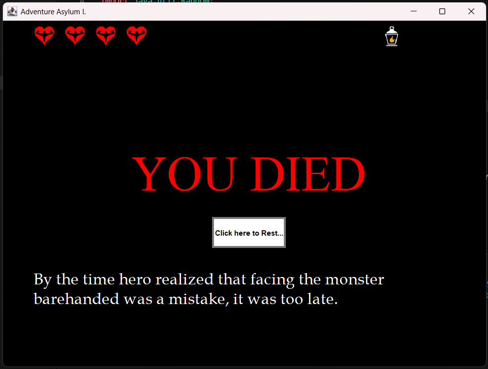
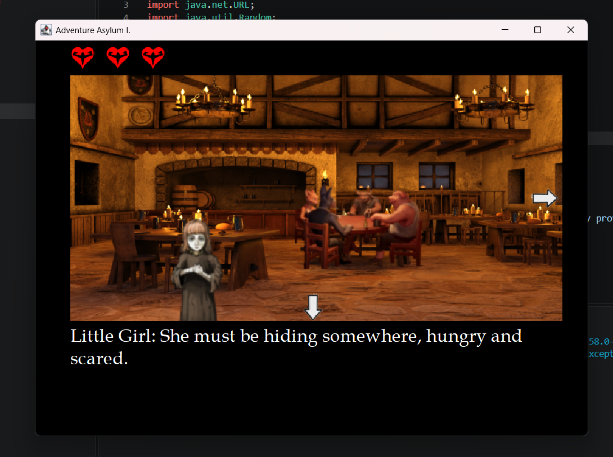
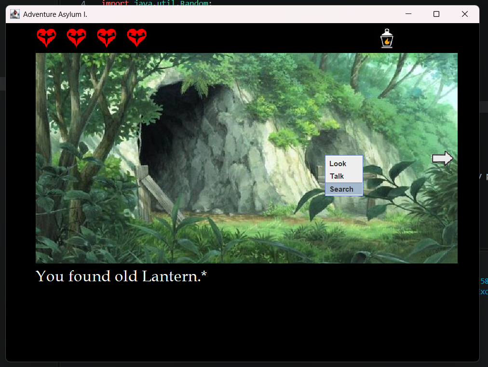

# ⚔️ Adventure Asylum I.

Java Swing ile geliştirilmiş, **point-and-click** tarzında, mizah dozu yüksek bir mini macera oyunu.
Köyü korkunç bir canavardan kurtarmaya çalışan bir kahramanı yönetiyorsun... ya da en azından öyle sanıyorsun.

> Oyunda birden fazla son ve bir **gerçek son** var. Hepsini bulabilecek misin?

---

## 📸 Ekran Görüntüleri

| Ölüm Ekranı | Sahne 1 – Taverna | Sahne 2 – Mağara Girişi |
|:---:|:---:|:---:|
|  |  |  |

---

## 🎮 Nasıl Oynanır?

| Eylem | Kontrol |
|---|---|
| Nesneyle etkileşim | Nesneye **sağ tık** → açılan menüden seçim yap (Look / Talk / Attack ...) |
| Sahne değiştirme | Ekrandaki **ok butonlarına** sol tık |
| Yeniden başlama | Ölünce / oyun bitince **"Click here to Restart"** butonu |

Ekranın üstünde solda **canların** (❤️), sağda **envanterin** görünür.
Alttaki siyah kutuda ise oyunun anlatımı ve diyaloglar yer alır.

### 🎒 Envanter Öğeleri

| Öğe | Nasıl Kazanılır? |
|---|---|
| 🗡️ Kılıç | Köydeki sandıktan |
| 🛡️ Kalkan | Şövalyeye... "özel" bir yöntemle |
| 🏮 Fener | Mağara girişindeki küçük deliği ara |
| 💳 Kart | Sandığın içinden |
| 🍖 Et | Bardan satın alınır |
| 🐺 Kurt | Canavarı *doğru şekilde* etkisiz hale getirerek |

---

## 🗺️ Sahneler

| No | Sahne | Açıklama |
|:--:|---|---|
| 1 | Köy | Kulübe (Tavern), Şövalye ve Sandık |
| 2 | Mağara Girişi | Ana mağara ve küçük delik |
| 3 | Mağara İçi | Gizemli bir köpek... |
| 4 | Canavar Mağarası | Final karşılaşması |
| 6 | Tavern | Yalancılar masası ve küçük kız |
| 9 | Bar | Barmen ve Steve |
| 10 | Mağara (Kurtla) | Kurt evcilleştirildikten sonraki mağara |

---

## 🏁 Sonlar

Spoiler istemiyorsan bu bölümü açma! 👇

<details>
<summary><b>⚠️ Sonları Göster (SPOILER)</b></summary>

<br>

| Son | Nasıl Ulaşılır? |
|---|---|
| 💀 **Game Over** | Kılıçsız şövalyeye saldırıp canını kaybetmek **veya** kılıçsız ve etsiz canavardan kaçmaya çalışmak |
| 🪦 **Kahraman ve Köpeğin Ölümü** | Kılıç var, kalkan yok, canavara 1 canla saldırmak |
| 🏆 **Köyün Kurtuluşu** | Kılıç **ve** kalkanla canavara saldırmak |
| 🎁 **Mimic Sonu** | Sandıkla defalarca sohbet etmek |
| 🃏 **Yalancı Sonu** | Yalancılar masasına katılmak (kazanma şansı sadece %20) |
| 💖 **Gerçek Son** | Canavarı evcilleştirip küçük kıza götürmek |

### 🔑 Gerçek Sona Giden Yol (Kısa Rehber)

1. Köydeki sandığı aç → **Kılıç**, sonra tekrar aç → **Kart**
2. Mağara girişindeki küçük deliği ara → **Fener**
3. Tavern'e gir, Bar'a git → Barmenden iki kez *Buy* yap → **Et**
4. Mağaraya gir, köpekle konuş
5. Canavara karşı **Distract** seç → canavar artık seni takip ediyor 🐺
6. Tavern'deki küçük kıza dön ve **Gift** seç ❤️

</details>

---

## 🛠️ Kurulum ve Çalıştırma

### Gereksinimler
- **JDK 8** veya üzeri
- Kaynak dosyalar (resimler ve `.wav` sesleri) classpath içinde olmalı

### Eclipse ile
1. Projeyi **File → Import → Existing Projects into Workspace** ile içe aktar.
2. Resim ve ses dosyalarının bulunduğu klasörün **source folder** olarak eklendiğinden emin ol.
3. `Main.GameManager` sınıfına sağ tık → **Run As → Java Application**.

### Komut Satırı ile
```bash
# Derleme
javac -d bin src/Main/*.java src/Event/*.java

# Çalıştırma (kaynak dosyalar res/ klasöründeyse)
java -cp bin:res Main.GameManager      # Linux / macOS
java -cp "bin;res" Main.GameManager    # Windows
```

> ⚠️ Ses dosyaları **`.wav`** formatında olmalı (Java Sound API kullanılıyor).

---

## 📁 Proje Yapısı

```
AdventureAsylum/
├── src/
│   ├── Main/
│   │   ├── GameManager.java    # Oyunun merkezi (hub), ses URL'leri, main()
│   │   ├── UI.java             # Pencere, sahneler, nesneler, envanter ve can arayüzü
│   │   ├── Player.java         # Oyuncu durumu (can, envanter, sayaçlar)
│   │   ├── SceneChanger.java   # Sahne geçişleri ve son ekranları
│   │   ├── ActionHandler.java  # Menü/buton olaylarını ilgili event'e yönlendirir
│   │   ├── Music.java          # Döngüsel arka plan müziği
│   │   └── SE.java             # Ses efektleri
│   └── Event/
│       ├── Event01.java        # Köy: Kulübe, Şövalye, Sandık
│       ├── Event02.java        # Mağara girişi
│       ├── Event03.java        # Mağara içi: Köpek
│       ├── Event04.java        # Canavar savaşı
│       ├── Event06.java        # Tavern: Yalancılar masası, Küçük kız
│       └── Event09.java        # Bar: Barmen, Steve
├── res/                        # Resimler ve audio/*.wav dosyaları
└── screenshots/                # README görselleri
```

### 🧩 Mimari

Oyun, **GameManager'ın merkez olduğu (hub)** basit bir yapıya sahip:

```
 Sağ tık menüsü / Ok butonu
            │
            ▼
      ActionHandler ──(actionCommand)──► EventXX.metot()
                                               │
                      ┌────────────────────────┼───────────────────┐
                      ▼                        ▼                   ▼
                   Player                 SceneChanger         Music / SE
             (can, envanter, sayaç)    (sahne / son ekranı)       (ses)
                      │
                      ▼
                     UI
```

- **UI** her nesne için sağ tık menüsünü (`JPopupMenu`) oluşturur, her seçeneğe bir *action command* atar.
- **ActionHandler** bu komutu okuyup ilgili `EventXX` metodunu çağırır.
- **EventXX** sınıfları oyun mantığını ve diyalogları barındırır.
- **Player** durum değişkenlerini tutar ve `updatePlayerStatus()` ile arayüzü günceller.
- **SceneChanger** `bgPanel[]` dizisindeki panelleri açıp kapatarak sahne değiştirir.

### ➕ Yeni Etkileşim Eklemek

1. `UI.generateScene()` içinde `createObject(...)` ile yeni nesneyi ve 3 komutunu tanımla.
2. İlgili `EventXX` sınıfına komutlara karşılık gelen metotları yaz.
3. `ActionHandler`'daki `switch` bloğuna yeni `case` satırlarını ekle.

---

## 👤 Geliştirici

**Yunus Bahadır**
Bu proje, Java ile oyun geliştirme çalışması olarak hazırlanmıştır.

---
